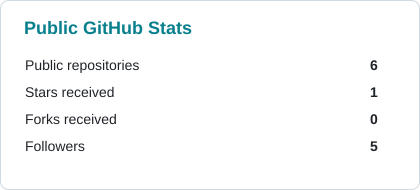
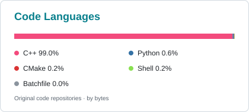
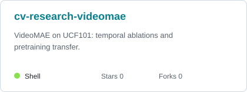
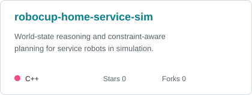

  <picture><source media="(prefers-color-scheme: dark)" srcset="https://raw.githubusercontent.com/CassieuiL/CassieuiL/main/assets/hello-cassie.png" /><source media="(prefers-color-scheme: light)" srcset="https://raw.githubusercontent.com/CassieuiL/CassieuiL/main/assets/hello-cassie-light.png" /></picture>

I'm exploring **Embodied AI** through hands-on work in robot perception, control, and video understanding.

**About me**

- 🔭 My direction: **Perception → Understanding → Reasoning → Planning → Action**.
- 🤖 Building a practical foundation in **ROS 2, robot control, and visual perception** through industrial robotics projects.
- 🛠️ Completed an **end-to-end screw recovery and re-pickup workflow**, covering visual localization, robot motion, release verification, and feedback-based retries.
- 🎬 Exploring **VideoMAE and Qwen3-VL** for action recognition, process understanding, and SOP verification, with plans to extend this work toward **VLA and WAM**.
- ⚙️ Using **YOLO, OpenCV, BentoML, and FastAPI** to build perception pipelines and model services, with a focus on **reproducible evaluation and reliable integration**.

  <code></code>&nbsp;
  <code></code>&nbsp;
  <code></code>&nbsp;
  <code></code>&nbsp;
  <code></code>&nbsp;
  <code></code>&nbsp;
  <code></code>&nbsp;
  <code></code>

  <a href="https://github.com/CassieuiL?tab=repositories"><picture><source media="(prefers-color-scheme: dark)" srcset="https://raw.githubusercontent.com/CassieuiL/CassieuiL/profile-cards/stats-equal.svg" /><source media="(prefers-color-scheme: light)" srcset="https://raw.githubusercontent.com/CassieuiL/CassieuiL/profile-cards/stats-equal-light.svg" /></picture></a>
  <a href="https://github.com/CassieuiL?tab=repositories"><picture><source media="(prefers-color-scheme: dark)" srcset="https://raw.githubusercontent.com/CassieuiL/CassieuiL/profile-cards/languages-equal.svg" /><source media="(prefers-color-scheme: light)" srcset="https://raw.githubusercontent.com/CassieuiL/CassieuiL/profile-cards/languages-equal-light.svg" /></picture></a>

#### Top Repositories

  <a href="https://github.com/CassieuiL/cv-research-videomae"><picture><source media="(prefers-color-scheme: dark)" srcset="https://raw.githubusercontent.com/CassieuiL/CassieuiL/profile-cards/videomae.svg" /><source media="(prefers-color-scheme: light)" srcset="https://raw.githubusercontent.com/CassieuiL/CassieuiL/profile-cards/videomae-light.svg" /></picture></a>
  <a href="https://github.com/CassieuiL/robocup-home-service-sim"><picture><source media="(prefers-color-scheme: dark)" srcset="https://raw.githubusercontent.com/CassieuiL/CassieuiL/profile-cards/planner.svg" /><source media="(prefers-color-scheme: light)" srcset="https://raw.githubusercontent.com/CassieuiL/CassieuiL/profile-cards/planner-light.svg" /></picture></a>

Also exploring [RGB-D data collection](https://github.com/CassieuiL/orbbec-live-rgb-collector) · [PyTorch training foundations](https://github.com/CassieuiL/cv-research-2026).

#### Contribution Snake

<picture>
  <source media="(prefers-color-scheme: dark)" srcset="https://raw.githubusercontent.com/CassieuiL/CassieuiL/output/github-contribution-grid-snake-dark.svg" />
  <source media="(prefers-color-scheme: light)" srcset="https://raw.githubusercontent.com/CassieuiL/CassieuiL/output/github-contribution-grid-snake.svg" />
  
</picture>
